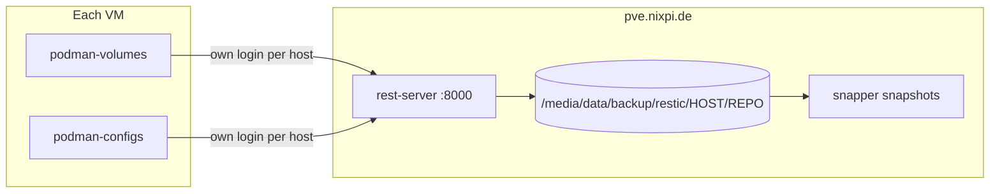

# Backups and restore

Every VM backs up its Podman volumes and Quadlet files with restic to a rest-server on `pve.nixpi.de`.

## How it works



| Time           | Job              | What happens                                                                                        |
| -------------- | ---------------- | --------------------------------------------------------------------------------------------------- |
| 01:00          | `podman-configs` | Backs up `/home/container/.config/containers/systemd`                                               |
| 01:30          | Postgres dump    | `git` and `login` dump their database into a volume                                                 |
| 02:00          | `podman-volumes` | Stops the pods, backs up `/home/container/.local/share/containers/storage/volumes`, starts the pods |
| Sunday 03:00   | Check            | Reads 10% of the repository data                                                                    |
| Saturday 04:00 | Restore test     | Restores 20 random files and fails if the latest snapshot is older than 36 hours                    |

- The pods to stop are in `backup_stop_units` in `ansible-playbook/inventories/backup/host_vars/<host>/restic.yaml`.
- After each backup, restic keeps 14 daily, 8 weekly, 12 monthly and 3 yearly snapshots and prunes the rest.
- A host can only reach its own repositories. Its login is derived from `restic_server_secret` and the inventory hostname.
- Repositories deduplicate per repository, not across hosts. Data moved to another host takes up space twice until the
  old snapshots expire.
- Logs are in `/etc/resticprofile/logs` on each VM.

## Restore with the playbook

Use `-l` with one host. `restic_restore_repository` defaults to `podman-volumes`, `restic_restore_snapshot` to `latest`.

```bash
# List snapshots
just deploy backup --playbook restore.yaml -l <host> -e restic_restore_action=snapshots

# List a path
just deploy backup --playbook restore.yaml -l <host> -e restic_restore_action=ls \
  -e '{"restic_restore_paths": ["/home/container/.local/share/containers/storage/volumes"]}'

# Copy to /var/tmp/restic-restore/<repo>-<time> on the host, live data stays untouched
just deploy backup --playbook restore.yaml -l <host> -e restic_restore_action=files \
  -e '{"restic_restore_paths": ["<path>"]}'

# Replace live data: stops the pods, moves the paths to <path>.pre-restore-<time>, restores, starts the pods
just deploy backup --playbook restore.yaml -l <host> -e restic_restore_action=inplace \
  -e '{"restic_restore_paths": ["<path>"]}'
```

Delete the `.pre-restore-*` directory once the service looks right.

## Work on a repository by hand

On the VM as root, `restic-repo <repo> <restic args>` has the login and password set:

```bash
restic-repo podman-volumes snapshots
restic-repo podman-volumes ls latest
```

Restore as root and never `chown` afterwards: volumes contain files owned by subuids.

## Lost host

1. Recreate the VM with OpenTofu.
1. `just deploy container -l <host>`, then `just deploy backup -l <host>,pve.nixpi.de`.
1. Run an `inplace` restore of the volumes.

## Rename a host

The inventory hostname is part of the repository path and the login, and retention only looks at snapshots of the
current hostname. Without these steps, old snapshots never expire and the next backup has no parent.

1. On pve, move `/media/data/backup/restic/<old>` to `<new>`.
1. `just deploy backup -l <new>,pve.nixpi.de`, then remove the old login from `.htpasswd`.
1. On the VM, for each repository:

```bash
restic-repo <repo> rewrite --new-host <short name> --forget
restic-repo <repo> tag --remove <old> --add <new> --tag <old>
```

## Not covered

- No offsite copy: all backups are on one SSD in pve. Snapper protects against deletion, not disk failure.
- No alerting on failed backups.
- rest-server has no TLS, logins travel in clear text between VLANs.
