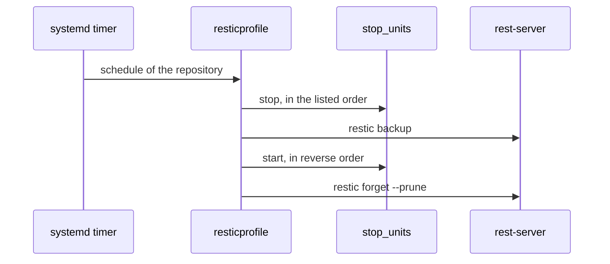

# restic

Backs up paths to a rest-server with [restic](https://restic.net) and
[resticprofile](https://creativeprojects.github.io/resticprofile/), and restores them again.

`restic_mode` selects what a host does: `client`, `server` or `both`.

## How it works



The units start again even when the backup fails.

### Client

- `restic_repositories` defines the repositories. Each one becomes a resticprofile profile with its own timer.
- The repository URL is `rest:http://<restic_server_host>:<restic_server_port>/<inventory_hostname>/<name>`.
- `/usr/local/bin/restic-repo <name> <restic args>` runs restic with the login and password of that repository.
- A weekly check reads 10% of the data of each repository.
- A weekly restore test restores `restic_restore_test_files` random files from the latest snapshot of each repository.
  It fails when a file does not match or the snapshot is older than `restic_restore_test_max_age_hours`.

### Server

- Runs rest-server with `--private-repos` as `restic_user`, below `restic_server_repo_base`.
- Creates one directory and one bcrypt login in `.htpasswd` per host in the `restic_clients` group. The login name is
  the inventory hostname, so a client can only reach its own repositories.
- The server reads `restic_server_password` of every client, so run it in the same play as the clients.

## Usage

```yaml
restic_mode: client
restic_server_host: backup.example.org
restic_server_password: "{{ encrypted_login }}"
restic_stop_units_user: container

restic_repositories:
  - name: podman-volumes
    password: "{{ encrypted_repo_password }}"
    backup_paths:
      - /home/container/.local/share/containers/storage/volumes
    stop_units:
      - vaultwarden-pod.service
    schedule: "*-*-* 02:00:00"
```

`stop_units` are user units of `restic_stop_units_user`. Entries without `retention` or `exclude_patterns` use
`restic_repository_defaults`.

## Restore

`tasks_from: restore` runs the action in `restic_restore_action` on a repository:

| Action      | What it does                                                                                |
| ----------- | ------------------------------------------------------------------------------------------- |
| `snapshots` | Lists the snapshots                                                                         |
| `ls`        | Lists `restic_restore_paths` of a snapshot                                                  |
| `files`     | Restores the paths below `restic_restore_target`, live data stays untouched                 |
| `inplace`   | Stops the units, moves the paths to `<path>.pre-restore-<time>`, restores, starts the units |

When an `inplace` restore fails, the previous data is put back. It only runs on a single host.

Restore as root and never `chown` afterwards when volumes contain files owned by subuids.
